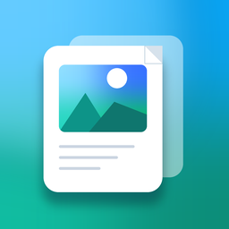

# 照片转 PDF / 文档扫描（Photo2PDF v2.0）

拍纸质文档或从相册选照片，拼成一份**可以打印、可以分享、可以存档**的 PDF。原生 SwiftUI、**iOS 15.0 起**、中文界面、零第三方依赖、全部在本机处理（不上传任何内容）。

> **v2.0 新增**：相机扫描（系统 VisionKit，自动找边 + 透视校正 + 多页连拍）、增强滤镜（原图 / 增强 / 黑白 / 灰度，接近全能扫描王）、识别文字（Vision OCR，简体中文 + 英文）。

<p align="center">
  
</p>

---

## 一、先说最重要的：怎么在没有 Mac 的情况下装上它

iPhone App 必须由 macOS 上的 Xcode 编译，**但你不必拥有 Mac**。GitHub 提供免费的 macOS 云机器，本项目自带一条流水线（`.github/workflows/build-ipa.yml`）：

```
你的 GitHub 仓库  ──▶  GitHub Actions（免费 macOS 机器）  ──▶  未签名 .ipa（下载）
                                                                    │
                                          Sideloadly / AltStore（Windows 电脑 + 你的 Apple ID 自签）
                                                                    ▼
                                                              安装到 iPhone
```

整条路你只需要：**一个免费 GitHub 账号** + **一台 Windows 电脑** + **一个 Apple ID**。不用 Mac、不用开发者账号（99 美元那种不需要）、不用交钱。

> ⚠️ 免费 Apple ID 自签有 iOS 系统的硬限制：**签名 7 天过期**、**最多同时装 3 个自签 App**。过期后重新用 Sideloadly 装一次同一个 ipa 即可（照片数据会保留在 App 外，重新装不会丢）。详见 [第五节](#五用-sideloadly-自签安装windows-上最省事)。

---

## 二、功能

| 分类 | 能力 |
| --- | --- |
| 扫描（v2.0） | 相机拍纸质文档：系统 VisionKit 自动找边、透视校正、**多页连拍**，拍完直接进列表；模拟器不支持（真机可用） |
| 选照片 | 系统 `PHPicker`（iOS 14 起的相册选择器）多选，一次最多 60 张，支持 HEIC / JPEG / PNG，**不需要相册权限**，只把你选中的照片交给 App |
| 滤镜（v2.0） | 原图 / 增强 / 黑白 / 灰度（Core Image）；缩略图与最终 PDF 都按所选滤镜渲染；扫描件默认「增强」 |
| 整理 | 缩略图网格、长按拖动排序、右键菜单「前移 / 后移」、单张删除、一键清空；扫描页带相机小标记 |
| 旋转 | 单张顺时针旋转 90°（网格里实时预览），旋转结果会写进 PDF，OCR 前也会自动摆正 |
| 页面设置 | 纸张 A4 / Letter / 自动；方向 纵向 / 横向 / 自动；页边距 无 / 小 / 标准 / 大；清晰度 150 / 300 / 450 DPI；JPEG 质量 50%–100%；文件名可改；滤镜选择 |
| 生成 | 异步多页 PDF（约 300 DPI 目标）、自动套用 EXIF 方向、等比缩放居中、逐页解码 + 逐页滤镜（内存友好）、进度条 + 随时取消 |
| OCR（v2.0） | 结果页「识别文字」：Vision 精确模式，简体中文 + 英文，可复制全部；有进度和取消（v2.0 不写入 PDF 文字层） |
| 导出 | 系统分享面板（可存「文件」、发微信、AirDrop、打印）+ 一键「存储到“文件”」 |
| 适配 | 深色模式、iPhone 竖屏 + iPad 四方向、动态字体、VoiceOver 标签 |

### 兼容性（支持 iOS 15.0 及以上，iOS 15.1 真机可装）

| 项 | 说明 |
| --- | --- |
| **最低系统** | **iOS 15.0**（你的 iOS 15.1 设备可以直接安装、直接运行） |
| 最高系统 | 可以装到最新版 iOS（本项目没有用任何「只在旧系统才有」的 API） |
| 设备 | iPhone / iPad 通用（同一份 ipa） |
| 相机扫描 | `VNDocumentCameraViewController`（VisionKit，**iOS 13.0**）——**模拟器不可用**，真机才支持；界面会先判断 `isSupported`，模拟器上自动隐藏「扫描」按钮 |
| 滤镜 | Core Image（`CIColorControls` / `CIUnsharpMask` / `CIHighlightShadowAdjust`，iOS 5 起） |
| OCR | Vision `VNRecognizeTextRequest`（**iOS 13.0**），语言 `zh-Hans` + `en-US` |
| 相册选择 | 用 `PHPickerViewController`（iOS 14 API）桥接成 `MultiPhotoPicker`，替代 iOS 16 才有的 `PhotosPicker` |
| 导航 | 用 `NavigationView`（iOS 13 API）+ `StackNavigationViewStyle()` 替代 iOS 16 的 `NavigationStack`，iPad 上强制单栏，观感与原来一致 |
| `#available` 分支 | **0 个** —— 所有用到的 API 在 iOS 15.0 都有，不需要版本判断 |
| 编译警告 | 在 Xcode 15/16 下编译会遇到 `NavigationView`、「单参数 onChange」的**弃用警告**，属正常，不影响编译与运行（工程已关闭「警告视为错误」） |

> 想在更高系统上换成新 API（`NavigationStack` / `PhotosPicker`）？把 `project.yml` 里的 `IPHONEOS_DEPLOYMENT_TARGET` 改回 `16.0`，再用 `#available` 包一层即可 —— 但这样 iOS 15 设备就装不上了。

---

## 三、目录结构

```
photo2pdf/ios/
├── project.yml                      # XcodeGen 工程描述（生成 .xcodeproj；版本 2.0.0）
├── Sources/
│   ├── App/
│   │   └── Photo2PDFApp.swift       # @main 入口
│   ├── Models/
│   │   ├── PhotoItem.swift          # 一张照片/扫描页（磁盘路径 + 缩略图 + 旋转 + 来源）
│   │   └── PDFOptions.swift         # 页面设置（纸张/方向/边距/DPI/质量/文件名/滤镜）
│   ├── Services/
│   │   ├── ImageTools.swift         # ImageIO 降采样、EXIF 尺寸、90° 旋转
│   │   ├── ImageEnhancer.swift      # v2.0 Core Image 滤镜（原图/增强/黑白/灰度）
│   │   ├── TextRecognizer.swift     # v2.0 Vision OCR（zh-Hans + en-US）
│   │   ├── OCRController.swift      # v2.0 OCR 流程（actor 串行 + 进度/取消）
│   │   ├── PhotoFileImporter.swift  # PHPicker 结果 → 磁盘文件（loadFileRepresentation 优先）
│   │   ├── PhotoStore.swift         # 照片列表：导入/扫描/排序/删除/旋转/滤镜缩略图
│   │   ├── PDFGenerator.swift       # PDF 核心：排版 + 逐页解码 + 滤镜 + CGPDFContext 绘制
│   │   ├── PDFGenerationController.swift # 生成状态机（进度/取消/结果）
│   │   └── PDFFileDocument.swift    # 「存储到文件」用的 FileDocument
│   └── Views/
│       ├── ContentView.swift        # 主界面：网格 + 工具栏（扫描/照片）+ 底部按钮
│       ├── DocumentScannerView.swift # v2.0 VisionKit 相机扫描桥接 + 权限判断
│       ├── MultiPhotoPicker.swift   # PHPickerViewController 桥接（iOS 15 兼容多选）
│       ├── EmptyStateView.swift     # 空状态引导（扫描 / 从相册选择）
│       ├── PhotoGridCell.swift      # 缩略图格子（含扫描件标记）
│       ├── SettingsView.swift       # 页面设置面板（含滤镜选择）
│       ├── GeneratorFlowView.swift  # 生成进度 / 结果页
│       ├── ResultView.swift         # 分享 / 存储到文件 / 识别文字
│       ├── OCRSheetView.swift       # v2.0 OCR 结果面板（可复制）
│       └── ShareSheet.swift         # UIActivityViewController 桥接
├── Resources/
│   └── Assets.xcassets/             # AppIcon（1024 单尺寸）+ AccentColor（含暗色变体）
├── .github/workflows/build-ipa.yml  # 云端编译未签名 ipa（未改动）
├── scripts/
│   ├── make_ipa.sh                  # macOS 本地一键打包
│   ├── generate_app_icon.py         # 用 Pillow 生成图标（可重跑）
│   └── self_check.py                # 自检：Swift 语法树 + iOS15 扫描 + 扫描功能检查
└── docs/
    ├── SELF-CHECK.md                # 最近一次自检报告
    └── icon-preview.png
```

---

## 四、方式一：在 GitHub 上点几下拿到 IPA（不需要 Mac）

### 第 1 步：注册并新建仓库

1. 打开 <https://github.com>，注册一个免费账号（只需邮箱）。
2. 右上角 **+** → **New repository**。
3. 名字随便填（例如 `photo2pdf-ios`），选 **Public**（私有仓库也能用，但公开仓库的 Actions 分钟数无限），点 **Create repository**。

### 第 2 步：把本项目上传上去

新手用网页上传最简单：

1. 进入刚建好的仓库，点 **Add file** → **Upload files**。
2. 把 **`photo2pdf/ios/` 目录里的全部内容**（`project.yml`、`Sources/`、`Resources/`、`.github/`、`scripts/`、`docs/`、`README.md`）一起拖进浏览器窗口。
3. 注意：`.github` 是隐藏文件夹。Windows 资源管理器里打开「查看 → 显示 → 隐藏的项目」才能看到它。
   **没有 `.github/workflows/build-ipa.yml` 就没有自动编译**，务必确认它被上传（上传后仓库首页应能看到 `.github` 目录）。
4. 底部点 **Commit changes**。

> 如果你的仓库里已经放了 `photo2pdf/web` 之类的其它项目也没关系：工作流会自动在 `.`、`ios/`、`photo2pdf/ios/` 里寻找 `project.yml`。
> 但请把 `.github/workflows/build-ipa.yml` 放在**仓库根目录的 `.github/workflows/`** 下，GitHub 只认这个位置。

### 第 3 步：运行编译

1. 仓库页面顶部点 **Actions**。
2. 首次会提示启用工作流，点绿色按钮 **I understand my workflows, go ahead and enable them**。
3. 左侧列表点 **Build Unsigned IPA**。
4. 右侧点 **Run workflow** → 分支选 `main` → 绿色 **Run workflow**。
5. 列表里会出现一条正在跑的记录（黄色小圆点），点进去可以看到实时日志。**大约 5～10 分钟**。
6. 等到变成绿色 ✅，把页面拉到底部 **Artifacts** 区域，点 **Photo2PDF-unsigned-ipa** 下载（是个 zip）。
7. 解压 zip，里面就是 **`Photo2PDF-unsigned.ipa`**（别在手机上下载 zip，Windows 上解压更方便）。

也可以 push 到 `main` 分支自动触发；打一个 `v1.0.0` 的 tag 还会自动发到 **Releases** 页面，链接更直观。

### 第 4 步：安装到 iPhone

见下一节。**未签名 ipa 不能直接双击安装，必须用工具用你自己的 Apple ID 重签。**

---

## 五、用 Sideloadly 自签安装（Windows 上最省事）

### 准备

1. **Sideloadly**：从官网 <https://sideloadly.io/> 下载 Windows 版并安装。
2. **iTunes**：从 **Apple 官网下载**（<https://www.apple.com/itunes/download/win64>，**不要用 Microsoft Store 版本**）。
   Sideloadly 靠 iTunes 的驱动与 iPhone 通信，没装会是「无法连接设备 / Could not find device」。
3. iPhone 数据线，以及手机上信任这台电脑。
4. 你的 **Apple ID**（免费账号即可，建议先开启双重认证）。

### 安装步骤

1. iPhone 上：**设置 → 隐私与安全性 → 开发者模式 → 打开**。注意这一步**只有 iOS 16 及以上才需要**；你的 iOS 15.1 没有这个开关，装完直接做下面第 5 步「信任开发者」即可。
2. 打开 Sideloadly，插上 iPhone：
   - **Apple ID**：填你的 Apple ID 邮箱；
   - **IPA / File**：选刚才下载的 `Photo2PDF-unsigned.ipa`；
   - **Device**：应自动识别出你的 iPhone（没识别 → 查 iTunes 驱动）。
3. 点 **Start**，输入 Apple ID 密码（会要求双重认证验证码）。
4. 进度到 100% 后手机上会出现「照片转 PDF」图标。
5. **第一次打开会提示「不受信任的开发者」**：
   **设置 → 通用 → VPN 与设备管理 → 开发者 App → 点你的 Apple ID → 信任**。
   然后回到桌面打开 App。

### 免费 Apple ID 的硬限制（一定要知道）

| 限制 | 说明 | 怎么办 |
| --- | --- | --- |
| **签名 7 天过期** | 过期后 App 打不开（闪退/提示不再可用） | 用 Sideloadly 重新装一次同一个 ipa（数据不丢），或改用 AltStore 自动续签 |
| **最多同时 3 个自签 App** | 免费账号同时只能有 3 个侧载 App（含本项目），装第 4 个会顶掉旧的 | 删掉不用的自签 App |
| **7 天最多创建 10 个 App ID** | 频繁重装/换 bundle id 会撞到这个限制，报 `maximum number of App IDs` | 等 7 天，**不要频繁改 bundle id** |
| 需要信任开发者 | 见上面第 5 步 | 每次重装后都要再信任一次 |

### 想一劳永逸？

- **AltStore + AltServer**：在 Windows 上跑 AltServer，iPhone 和电脑在同一 Wi-Fi 下会自动帮你续签（仍是 7 天一轮，但不用手动操作）。AltServer 需要 iTunes + iCloud（官网版）。
- **付费开发者账号（688 元/年）**：签名 1 年有效、可上 App Store。本项目不需要它，但如果你长期用，值。
- **越狱 / TrollStore**：不在本文档讨论范围，安全性自负。

> 只在**你自己的设备**上安装，不要分发这个 ipa 或替别人签名。

---

## 六、方式二：有 Mac 时本地构建

需要：macOS + Xcode（App Store 安装）+ Homebrew。

```bash
# 1. 安装 XcodeGen（用来生成 .xcodeproj）
brew install xcodegen

# 2. 在工程目录生成 Xcode 工程
cd photo2pdf/ios
xcodegen generate

# 3. 方式 A：生成未签名 ipa（给 Sideloadly 用）
./scripts/make_ipa.sh
#   产物：build/Photo2PDF-unsigned.ipa

#    方式 B：有开发者账号，直接装到自己手机
#    先在 project.yml 里把 DEVELOPMENT_TEAM 填成你的 Team ID，然后：
./scripts/make_ipa.sh --run
```

想改 **Bundle ID / 显示名称 / 版本号**，都在 `project.yml` 里改：

```yaml
PRODUCT_BUNDLE_IDENTIFIER: com.dsh.photopdf   # 换成你自己的，例如 com.你的名字.photopdf
INFOPLIST_KEY_CFBundleDisplayName: 照片转PDF    # 桌面图标下面的名字
MARKETING_VERSION: "1.0.0"
```

改完重新跑 `xcodegen generate` 即可。

---

## 七、页面设置怎么选（给非程序员）

| 设置 | 建议 |
| --- | --- |
| 纸张 | 国内打印店说「A4」就用 **A4**；美国/加拿大常用 **Letter**；只想把照片原样存成 PDF（不打印）用 **自动**（页面比例跟照片一致，没有白边） |
| 方向 | 留 **自动** 最省心：竖图用竖页、横图用横页。要统一成竖版就选纵向 |
| 页边距 | 要打印装订选 **标准（13mm）**；要满版选 **无边距**（家用打印机可能裁掉边缘 1–2 毫米） |
| 清晰度 | **300 DPI** 是照片打印标准；想文件小选 150；想更精细可选 450（文件更大、生成更慢） |
| 图片质量 | **80%** 是体积/画质的平衡点；100% 不重新压缩（PDF 会明显变大） |
| 文件名 | 中文、空格都支持，会自动去掉 `/ \ : * ? " < > \|` 等非法字符 |

生成后建议先点进「分享 → 打印预览」看一眼，确认没有旋转错、没有裁切。

---

## 八、扫描 / 滤镜 / 文字识别（v2.0 新增）

### 8.1 怎么扫描

1. 打开 App，点右上角 **相机图标**（或空状态页的「扫描文档」）。**第一次会弹相机授权**，点允许。
2. 把手机对准纸张，系统会自动识别纸张边缘（取景框变绿/变蓝表示已找到）；也可以手动拖四角调整。
3. 按快门 → 拍下一张；一张一张往下拍（**多页连拍**）。
4. 全部拍完点 **保存**：每页已经由系统做好**透视校正**（斜着拍也能拍正），回到 App 后进入缩略图网格。
5. 之后和照片完全一样：拖动排序、旋转、删除、设置页面、生成 PDF、分享/存「文件」、识别文字。

> 📷 **模拟器不支持相机扫描**（`VNDocumentCameraViewController.isSupported == false`），所以模拟器上「扫描」按钮会自动隐藏，只剩「照片」。真机（你的 iOS 15.1）可用。
> 如果误点了拒绝相机权限：`设置 → 照片转 PDF → 相机` 打开即可（App 会提示这句话）。

### 8.2 滤镜怎么选（设置页「扫描增强（滤镜）」）

| 滤镜 | 效果 | 适合 |
| --- | --- | --- |
| 原图 | 不做任何处理 | 拍照片、拍实物、想保留原始色彩 |
| **增强**（扫描默认） | 提亮阴影 + 提高对比 + 略降饱和 + 锐化 | 纸质文档、书页、发票、白板 —— 最接近全能扫描王 |
| 黑白 | 去色 + 强对比 + 锐化 | 纯文字材料，想文件更小、字更黑 |
| 灰度 | 去色但保留灰阶 | 有印章/照片的材料，不想丢掉层次 |

- 缩略图和最终 PDF **都按当前滤镜渲染**；切换滤镜时网格会逐张刷新（不会一次占用大量内存）。
- 滤镜是**非破坏性**的：原始扫描图一直原样保存在临时目录，随时可以换回「原图」。
- 扫描件默认会自动切成「增强」+「页面自动贴合图像」+「边距 0」+ 文件名 `扫描_yyyyMMdd_HHmm`；只有在你还没改过这些设置时才会自动套用，不会覆盖你的自定义。

### 8.3 识别文字（OCR）

1. 生成 PDF 后，在结果页点 **「识别文字（OCR）」**。
2. 系统会逐页识别（Vision 精确模式，简体中文 + 英文），带进度条，可随时取消。
3. 识别完弹出文字面板：可以长按选中部分文字，也可以点 **「复制全部」** 一次性复制到剪贴板（会跳过空白页、按页分段）。
4. 说明：**v2.0 只输出文字，不会把文字层写进 PDF**（PDF 里仍然是图片，只是更清晰）；文字层计划放在 v2.1。

> 识别效果小贴士：用「增强 / 黑白」滤镜、把纸拍正、别让阴影盖住字，识别率高很多。如果一页都没识别到，面板里会给出提示。

### 8.4 权限说明

| 权限 | 什么时候用 | 文案 |
| --- | --- | --- |
| **相机**（NSCameraUsageDescription） | 只在点「扫描」时用；不点不申请 | 「需要使用相机拍摄纸质文档来生成 PDF。照片只保存在你的手机里，不会上传到任何服务器。」 |
| 相册（NSPhotoLibraryUsageDescription） | **实际不需要**——PHPicker 是系统独立进程，只把你勾选的照片交给 App；这里保留用途描述，方便以后接入相册资产 | 「从相册选择照片生成 PDF 时，需要读取你选中的照片。……」 |

本 App **不申请**定位、麦克风、通讯录、通知等任何无关权限，也没有任何网络上传代码。

---

## 九、常见问题

**Q：Actions 跑红了怎么办？**
点进去看红色步骤的日志，最常见是：
1. 仓库里没找到 `project.yml` → 检查是否把 `ios/` 里的**内容**上传了（而不是上传了 `ios` 文件夹本身）；
2. `xcodegen` 安装失败 → 重跑一次（brew 偶尔抽风）；
3. 编译报错 → 把日志贴在 issue 里。

**Q：Artifacts 里没有文件 / 下载按钮灰的？**
只有**成功**的运行才会产出 artifact；失败的运行请在 `build-logs` 里看 `archive.log`。

**Q：Sideloadly 报 `Provision.cpp:68` / `Unable to install`？**
常见原因：iOS 版本过新而 Sideloadly 太旧（升级到最新版）、iCloud/iTunes 是 Microsoft Store 版（换成官网版）、手机上没开开发者模式、Apple ID 未开双重认证。

**Q：App 打开闪退？**
先确认设备是 **iOS 15.0 或更高**（本工程最低 iOS 15.0，iOS 15.1 真机实测目标）；再确认是**这一次**签名安装的（7 天过期会打不开，图标变灰/一点就闪退 → 重新用 Sideloadly 装）。

**Q：点「扫描」没反应 / 按钮不见了？**
- 模拟器没有相机 → 按钮会自动隐藏（这是设计行为）；
- 真机上如果按钮不在：确认设备有相机；如果点了没进入扫描，多半是相机权限被拒 → `设置 → 照片转 PDF → 相机` 打开。

**Q：iOS 15 上会不会少功能？**
不会。iOS 15 只是替换了几处「界面 API 的写法」（`NavigationStack`→`NavigationView`、`PhotosPicker`→`PHPicker`），选照片、扫描、滤镜、排序、旋转、生成 PDF、OCR、分享、存「文件」全都在。扫描和相册选择器都是系统原生界面，观感不变。

**Q：扫描件发灰 / 字不够黑？**
在设置页把滤镜切到「增强」或「黑白」；再用 300/450 DPI 重新生成 PDF。

**Q：OCR 识别不到中文？**
v2.0 用 Vision 的 `zh-Hans` + `en-US`；如果系统版本驱动不支持中文，会自动退回英文（至少不出错）。识别效果与拍摄质量关系很大，建议用「增强 / 黑白」滤镜、拍正、避免阴影。

**Q：App 图标下显示「照片转 PDF」，但打开是英文？**
本项目界面全中文；如果出现英文按钮，那是系统控件（如分享面板、文件选择器、相机界面）跟随系统语言，属正常。

**Q：照片很多会不会卡死？**
不会。生成时是**逐张解码、逐页滤镜、逐页绘制**，任何时刻内存里只有一页的位图；单次最多 60 张，超出会提示。生成中可以随时取消。

**Q：HEIC 照片会不会转坏？**
不会。导入时保留原始编码，生成时由 ImageIO 解码并套用 EXIF 方向，再按目标 DPI 降采样。

**Q：PDF 能不能加密/加密码？**
当前版本没有；有需要可以在 `PDFGenerator.swift` 的 `documentInfo` 里加 `kCGPDFContextUserPassword`。

---

## 十、技术说明（给想改代码的人）

- **为什么用 CGPDFContext 而不是 `UIGraphicsPDFRenderer`？** 后者整份文档只能有一个页面尺寸，而本 App 的「自动」模式需要每页独立 `MediaBox`。`CGPDFContext` 允许在 `beginPDFPage` 时传入每页的 `kCGPDFContextMediaBox`。
- **坐标翻转**：PDF 坐标系原点在左下角，绘制前统一 `translate(0, pageHeight) + scale(1, -1)` 翻转成「左上角原点、y 向下」，之后所有排版计算与 SwiftUI 一致。
- **旋转**：EXIF 方向由 `kCGImageSourceCreateThumbnailWithTransform` 处理；用户手动旋转在绘制时用 CTM 的 `rotate` 完成，不额外生成位图。
- **内存保护**：`CGImageSourceCreateThumbnailAtIndex` + `kCGImageSourceThumbnailMaxPixelSize` 直接解出「够用」的像素（= 内容区磅值 × DPI / 72，夹在 320…4096 之间，且不超过原图），画完立即释放。
- **并发**：`PDFRenderer` / `OCRRunner` 都是 `actor`，渲染/识别天然跑在后台执行器；`PDFGenerationController` / `OCRController` 用 `Task` + `is CancellationError` 管理取消；每页开始前 `Task.checkCancellation()`（Swift 并发在 iOS 15 原生可用）。
- **扫描（VisionKit，iOS 13）**：`VNDocumentCameraViewController` 自己完成「找边 → 透视校正 → 多页连拍」，`DocumentScannerView` 只是一层 `UIViewControllerRepresentable`；用 `.fullScreenCover` 全屏呈现；`isSupported` 为 false（模拟器）时界面隐藏入口；相机权限由 `AVCaptureDevice` 先判断/请求，避免进去黑屏。
- **滤镜（Core Image，iOS 5~）**：`ImageEnhancer` 用 `CIFilter(name:)` + KVC 老接口（兼容性最好），滤镜链是 `CIHighlightShadowAdjust → CIColorControls → CIUnsharpMask`；全局复用一个 `CIContext`；缩略图在 480px 上处理并缓存，PDF 在「降采样后的页面尺寸」上处理，都是逐张串行、画完即释放。
- **OCR（Vision，iOS 13）**：`VNRecognizeTextRequest`（`.accurate`、`zh-Hans` + `en-US`、语言校正），每页先降采样到 2400px、套用当前滤镜、按用户旋转摆正，再识别；识别结果只在面板里展示/复制，不写进 PDF。
- **iOS 15 兼容（本项目的核心约束）**：全部用 iOS 15 就能用的 API ——
  - 导航：`NavigationView` + `StackNavigationViewStyle()`（iOS 13）代替 `NavigationStack`（iOS 16）；
  - 选择照片：`PHPickerViewController`（iOS 14）经 `MultiPhotoPicker` 桥接，代替 `PhotosPicker` / `PhotosPickerItem`（iOS 16）；
  - 分享：`UIActivityViewController` 桥接（`ShareSheet`），不用 `ShareLink`（iOS 16）；
  - 弹层：去掉 `.presentationDetents`（iOS 16），sheet 用系统默认高度；扫描用 `.fullScreenCover`（iOS 14）；
  - 其它：`@StateObject`（14）、`.task(id:)`/`Task`（15/13+）、`fileExporter`（14）、`.tint`/`.background(.ultraThinMaterial)`/`Color(uiColor:)`（15）、`.textSelection`（15）、`.onChange(of:)` 单参数版（14）都可用。
  - **没有 `#available` 分支**：不需要版本判断就不会漏；如果以后要加 iOS 16+ 特性，用 `if #available(iOS 16, *) { ... } else { ... }` 并保留现有写法作为兜底。
  - 代价：Xcode 15/16 会对 `NavigationView`、单参数 `onChange` 报**弃用警告**——只是警告，编译不会失败（工程已设置不把警告当错误）。
- **iOS 15 相册取图**：`PHPickerConfiguration.preferredAssetRepresentationMode = .current` 保证 HEIC 拿到原始 HEIC；`PhotoFileImporter` 先用 `loadFileRepresentation`（临时 URL 只在回调内有效，所以**在回调里立刻复制**到 App 目录），失败再退回 `loadDataRepresentation`。

---

## 十一、自检

Windows 上没有 Swift 编译器，所以本项目用 **tree-sitter-swift** 做语法树解析（等价于「能不能通过词法/语法分析」），并用 PyYAML / JSON 校验工程与资产文件，另外对 v2.0 的扫描/滤镜/OCR 做「关键写法」静态检查：

```powershell
# 一次性准备（Windows）
"C:\Program Files\Python312\python.exe" -m venv .venv
.venv\Scripts\python.exe -m pip install tree-sitter tree-sitter-swift pyyaml

# 运行自检，结果写入 docs/SELF-CHECK.md
.venv\Scripts\python.exe scripts\self_check.py
```

自检包含 6 类检查：

1. **Swift 语法解析**：所有 `.swift` 用 tree-sitter-swift 解析，必须是 0 个 ERROR / MISSING（v2.0 为 22 个文件）；
2. **iOS 15 兼容扫描**：源码里不允许出现 `NavigationStack`、`PhotosPicker`、`.presentationDetents`、`ShareLink`、
   `ContentUnavailableView` 等 iOS 16+ API，也不允许 iOS 16 才有的 SF Symbol 和双参数 `onChange`；
3. **工程/资产/版本校验**：`project.yml` 与 workflow 的 YAML 合法性、最低版本必须是 15.0、**版本号必须是 2.0.0**、
   **必须有中文 `NSCameraUsageDescription`**、scheme、AppIcon、AccentColor、`Contents.json` 与图标 PNG（1024²、无 alpha）；
4. **`#available` 清单**：本项目预期是 **0 处**（改用等价 API 而不是版本判断）；
5. **风险扫描**：`try!` / `as!` / `fatalError` / TODO；
6. **扫描功能检查（v2.0）**：逐文件确认 VisionKit 扫描桥接、相机权限判断、Core Image 滤镜、Vision OCR、
   滤镜缩略图串行渲染、OCR 面板等关键实现都在，并列出新增 API 的最低系统版本表（见报告第 11 节）。

最近一次结果见 [`docs/SELF-CHECK.md`](docs/SELF-CHECK.md)（含「iOS 15 兼容清单」与「扫描功能检查」两节）。**注意**：语法检查通过 ≠ 编译通过，类型/API 层面的问题只能在 macOS 的 Xcode 上验证（见自检报告「仍需 macOS 验证」一节）。

---

## 十二、许可与免责

- 代码可自由修改自用。图标为本项目用 Pillow 生成，可随意替换。
- 本项目产出的 ipa 是**未签名**包，仅用于在**你拥有或获授权的设备**上自签安装；请遵守 Apple 的开发者协议，不要用于分发或商业绕过。
- 扫描识别（OCR）结果仅供个人整理资料使用，识别准确率受拍摄质量与系统版本影响。
- 「存储到文件」「分享」等系统面板行为由 iOS 版本决定，个别系统版本上文案可能略有差异。
